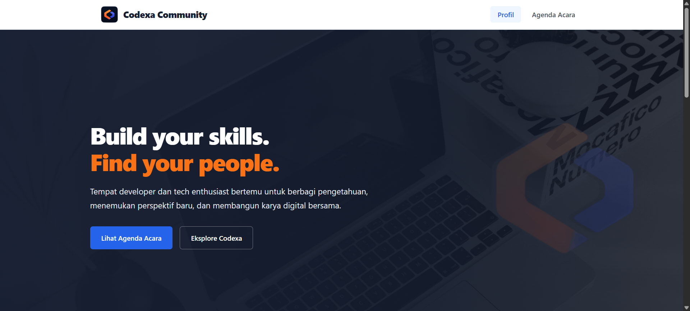
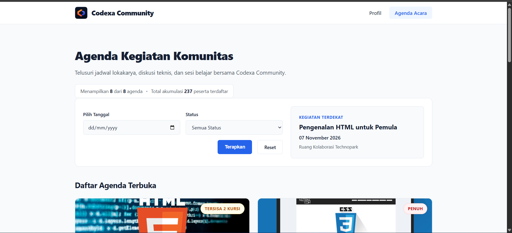
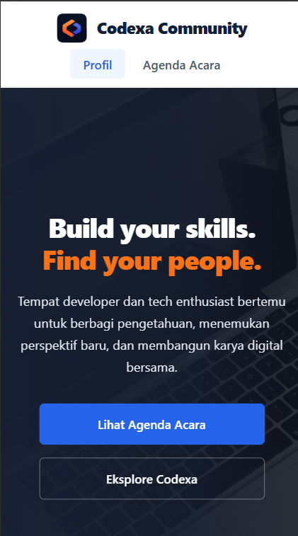

# Codexa Community - Platform Agenda & Profil Komunitas Developer

Proyek Mini Ujian Tengah Semester (UTS) mata kuliah **Pemrograman Web (253A23W15)**, Program Studi Informatika, Fakultas Teknik, Tiga Serangkai University.

---

## 1. Identitas Mahasiswa

- **Nama Lengkap**  : Muhammad Arief Hermawan
- **NIM**           : 025A00230004
- **Program Studi** : S1 - Informatika
- **Mata Kuliah**   : Pemrograman Web (253A23W15)

---

## 2. Deskripsi Tema Proyek

**Codexa Community** (*Code. Learn. Evolve.*) adalah platform profil dan katalog kegiatan komunitas pemrograman independen. Website ini dirancang untuk memfasilitasi publikasi kegiatan lokakarya teknologi, sesi bedah kode, dan ruang diskusi teknis. Seluruh data agenda dikelola secara dinamis melalui arsitektur server-side PHP murni tanpa menggunakan JavaScript, basis data SQL eksternal, maupun pustaka framework pihak ketiga.

---

## 3. Panduan Menjalankan Proyek di Localhost

Ikuti langkah-langkah berikut untuk menjalankan proyek pada server lokal:

1. **Persiapan Web Server PHP**

   Pastikan sudah memasang lingkungan server lokal seperti **Laragon** atau **XAMPP**, atau menggunakan PHP CLI Built-in Server. Gunakan PHP versi 8.1 atau lebih baru.

2. **Mengunduh Proyek**

   Unduh repositori proyek melalui GitHub dengan menuju ke tombol code di kanan atas repository lalu memilih **Download ZIP** atau menggunakan perintah Git:

   ```bash
   git clone https://github.com/ariefhermawan24/uts-pemweb-025A00230004.git
   ```

3. **Memindahkan Folder Proyek**

   Ekstrak atau tempatkan folder proyek ke dalam direktori root server lokal sesuai aplikasi yang digunakan:

   - **Laragon**: `C:/laragon/www/uts-pemweb-025A00230004`
   - **XAMPP**: `C:/xampp/htdocs/uts-pemweb-025A00230004`

4. **Menjalankan Web Server**

   Buka Laragon atau XAMPP, kemudian jalankan layanan web server (Apache). Pastikan status server sudah aktif sebelum melanjutkan.

5. **Membuka Proyek Melalui Browser**

   Buka browser, kemudian akses alamat berikut:

   ```text
   http://localhost/uts-pemweb-025A00230004/
   ```

6. **Memeriksa Halaman Website**

   Setelah halaman utama berhasil dibuka, navigasikan website melalui menu yang tersedia untuk memeriksa fitur dan halaman berikut:

   - **Profil** (`index.php`): Menampilkan informasi dan profil komunitas.
   - **Agenda Acara** (`katalog.php`): Menampilkan daftar agenda kegiatan serta fitur pendaftaran tiket sesi.

---

## 4. Daftar Fitur & Pemetaan Kode

| Fitur Utama | File Terkait | Fungsi / Logika Penanganan | Deskripsi Fungsional |
| :--- | :--- | :--- | :--- |
| **Pengamanan Tampilan Data** | `functions.php` | `e(string $string): string` | Membungkus `htmlspecialchars` untuk mengamankan teks sebelum dicetak ke dalam HTML. |
| **Konversi Tanggal Lokal** | `functions.php` | `tanggal_id(string $tanggal): string` | Mengonversi format tanggal numerik `YYYY-MM-DD` ke format tanggal tekstual bahasa Indonesia. |
| **Penentuan Status Kuota** | `functions.php` | `getStatusKuota(int $terdaftar, int $kuota): array` | Percabangan logika untuk menentukan indikator visual kuota (`status-full`, `status-warning`, `status-available`) beserta tombol aksi. |
| **Filter Agenda** | `katalog.php` | `array_filter()` & `$_GET` | Menyaring daftar agenda secara instan berdasarkan tanggal dan ketersediaan status kuota tanpa basis data. |
| **Deteksi Agenda Terdekat** | `katalog.php` | `usort()` & perbandingan `strtotime()` | Menyaring jadwal yang sudah lewat lalu mengurutkan dan menampilkan agenda paling dekat dari tanggal sistem saat ini. |
| **Ringkasan Akumulasi Data** | `katalog.php` | `array_sum()` & `array_column()` | Mengekstrak dan menjumlahkan total seluruh peserta terdaftar dari semua agenda secara dinamis ke panel header. |

---

## 5. Daftar Fungsi Array Bawaan PHP

Proyek ini mengimplementasikan 5 fungsi array bawaan untuk manipulasi data (melampaui syarat minimal 3 fungsi standar):

1. **`count()`**:
   * Digunakan untuk menghitung jumlah agenda yang lolos proses penyaringan (`count($render_katalog)`), menghitung total seluruh agenda (`count($katalog_agenda)`), serta memeriksa ketersediaan data untuk validasi *empty state*.
2. **`array_filter()`**:
   * Digunakan untuk menyaring item array `$katalog_agenda` berdasarkan parameter filter form (`$_GET['tanggal']` dan `$_GET['status']`), serta memisahkan agenda mendatang yang belum melewati tanggal hari ini.
3. **`usort()`**:
   * Digunakan untuk mengurutkan array agenda secara menaik (*ascending*) berdasarkan nilai konversi UNIX timestamp jadwal kegiatan.
4. **`array_column()`**:
   * Digunakan untuk mengekstrak kolom atribut `peserta_terdaftar` secara massal dari seluruh elemen yang ada di dalam data array.
5. **`array_sum()`**:
   * Digunakan untuk mengakumulasikan total seluruh angka peserta dari hasil ekstraksi `array_column()`.

---

## 6. Tangkapan Layar Aplikasi

Berikut gambar tangkapan layar dari tampilan website sesuai fungsionalitasnya:

### Tampilan Halaman Profil (`index.php`)


### Tampilan Halaman Katalog & Filter (`katalog.php`)


### Tampilan Responsif Ponsel (Mobile View)


---

## 7. Sumber Referensi & Catatan Pemakaian AI

- **Sumber Referensi & Aset**:
  * Aset Foto / Gambar: Menggunakan aset visual dari pencarian Google Image dan pustaka elemen Canva untuk gambar pada *card* agenda dan *hero section*.

- **Catatan Penggunaan AI & Verifikasi Kode**:
  Sesuai dengan ketentuan pengerjaan UTS, berikut adalah transparansi penggunaan AI selama proses pengembangan proyek ini:
  * **Bagian yang dibantu oleh AI**:
    1. **Perancangan Struktur, Tampilan, dan Konten:**: Diskusi untuk menentukan tema, menyusun kerangka HTML, memilih desain dan kombinasi warna layout, serta menyusun isi konten website seperti pengertian komunitas, deskripsi, informasi kegiatan, dan teks pendukung lainnya agar sesuai dengan tema komunitas yang dipilih.
    2. **Debugging Kode**: Membantu mencari tahu letak kesalahan penulisan (*syntax error*) pada baris kode PHP saat awal implementasi logika.
    3. **Pemahaman Alur Logika**: Digunakan  untuk menjelaskan cara kerja fungsi bawaan array PHP (seperti `array_filter`, `usort`, dan `array_sum`) agar saya lebih memahami alur datanya.
  * **Bagian yang saya kerjakan & Bagaimana saya memeriksanya**:
    1. **Pengujian Mandiri (Testing)**: Setiap baris kode yang dihasilkan dari diskusi dengan AI tidak disalin mentah-mentah, melainkan saya baca, pahami, dan uji coba langsung di *localhost* atau menggunakan inspect views untuk mengecek responsive.
    2. **Modifikasi Manual**: Saya melakukan penyesuaian variabel, nama fungsi, dan pembersihan CSS/HTML secara manual agar sesuai dengan standar *Clean Code* yang diwajibkan.